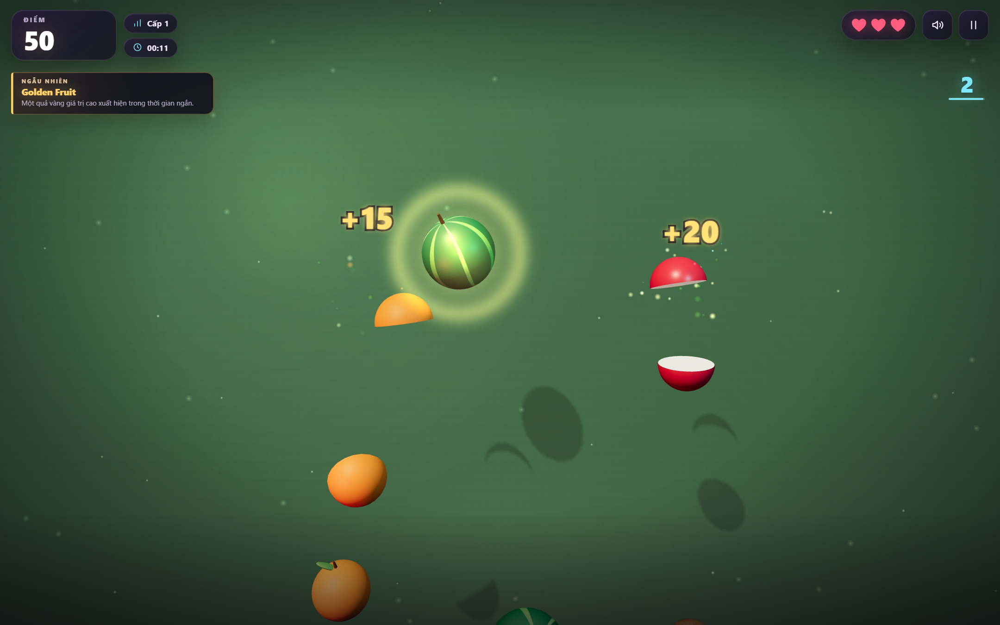

# Fruit Slash 3D

A 3D fruit-slicing arcade game that runs in the browser. Swipe through fruit, dodge bombs, build combos, and spend your coins on cosmetic effects and permanent upgrades. Built with TypeScript, Vite, and Three.js.



## Features

- **Swipe-to-slice gameplay** — drag with the mouse or swipe on a touch screen; every slash segment is checked against fruit and bomb hitboxes.
- **8 fruit types, bombs, and lives** — each fruit has its own point value and unlock time, and slicing a bomb costs one of your three hearts.
- **Combos and miss penalties** — chain slices inside the combo window for bonus points, but fruit that falls off-screen reduces your score.
- **Ramping difficulty** — waves get faster and denser, leveling up every 20 seconds up to level 10.
- **Live events** — Golden Fruit, Golden Rush, Frenzy, Slow Motion, Fruit Storm, Bomb Rush, Rainbow Fruit, and more can trigger mid-run.
- **Shop and upgrades** — unlock slash effects, backgrounds, fruit skins, trails, explosion styles, sound packs, and UI themes, plus permanent upgrades for coins, score, combos, and extra protection.
- **Persistent progress** — coins, purchases, loadouts, upgrades, statistics, achievements, and settings are saved with a versioned `localStorage` schema and migrations.
- **Procedural presentation** — fruit models, effects, backgrounds, and audio cues are generated at runtime, with no external art or audio files.
- **Responsive layout** — the camera and HUD adapt to landscape and portrait screens, with pause, settings, and game-over screens.

The in-game interface is currently in Vietnamese.

## Controls

| Action | Input |
| --- | --- |
| Slice fruit | Hold the left mouse button and drag, or swipe with a finger |
| Start / restart | `Enter` or `Space` |
| Pause / resume | `P` or `Esc` |
| Mute audio | Speaker button in the HUD |
| Pause | Pause button in the HUD |

Each run starts with three hearts. Missing fruit costs points, and hitting a bomb costs a heart.

## Getting started

Requirements: Node.js 20.19+ and a browser with WebGL 2.

```bash
npm install
npm run dev
```

Open the URL printed by Vite (http://localhost:5173 by default).

## Scripts

| Command | Description |
| --- | --- |
| `npm run dev` | Start the Vite dev server with hot module replacement |
| `npm run build` | Type-check and build the production bundle to `dist/` |
| `npm run preview` | Serve the production build locally |
| `npm run typecheck` | Run the TypeScript compiler without emitting files |
| `npm test` | Run the Vitest suite once |
| `npm run test:watch` | Run the Vitest suite in watch mode |

## Project structure

```text
src/
├── audio/        Web Audio synthesis and playback
├── config/       Game, economy, event, and fruit definitions
├── economy/      Coin balances and run rewards
├── entities/     Fruits, bombs, and the wave spawner
├── events/       Timed events and active event effects
├── game/         Game orchestration, state, loop, and difficulty
├── mechanics/    Slash input, collision detection, scoring, and lives
├── persistence/  Versioned save schema, storage, and migrations
├── rendering/    Three.js scene, procedural assets, and particles
├── shop/         Catalog, inventory, equipment, and upgrades
├── styles/       Game and shop styles
└── ui/           DOM screens, HUD, and overlays
tests/            Vitest coverage for economy, events, and spawning
```

## How it is built

- **Three.js** renders the scene, procedural fruit and bomb models, and particle effects.
- **Vite** provides the dev server and production bundling; the entire game is written in TypeScript.
- **DOM and CSS** drive the HUD, menus, shop, and overlays layered over the WebGL canvas.
- **Vitest** covers the economy, event manager, and spawner logic.

Progress is stored under the `fruit-slash-3d:save` key. Clearing site data resets it.
